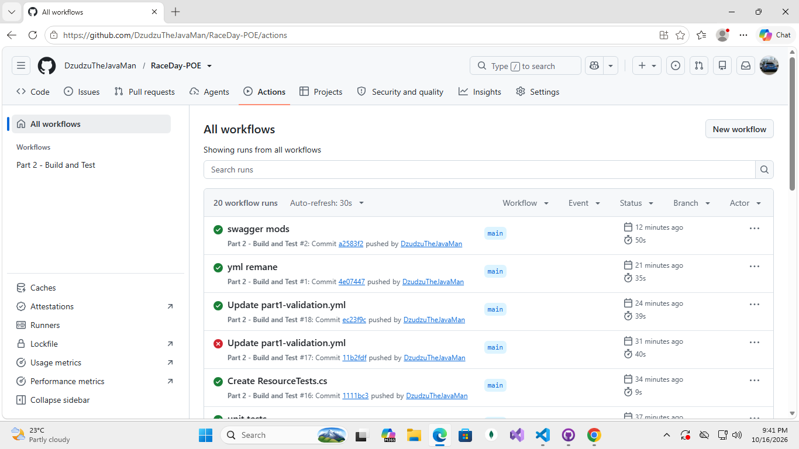

# RaceDay API (Part 2)

REPO LINK:https://github.com/DzudzuTheJavaMan/RaceDay-POE
PROG6212 PoE Part 2. A RESTful ASP.NET Core Web API for RaceDay, an event management system for South African road running, walking and cycling events.

Student: [ODZULAHO NEMBALENI], [ST10475597]

## Video

Not submitted for this part.

## CI/CD

GitHub Actions builds the project and runs all 35 unit tests on every push (`.github/workflows/`).



## Roles

- **Organiser**: creates, edits and deletes their own events, defines categories, views all enrolments for their events and captures results (finish time and position).
- **Participant**: browses events and categories, enrols in an event under a category, views their own enrolments and results.

The role is chosen at registration and stored in the server-side session at login. Every protected endpoint checks it: no session gives 401, the wrong role gives 403.

## Tech

- ASP.NET Core Web API (.NET 9), EF Core 9 Code-First, SQL Server
- Session authentication, with passwords hashed using PBKDF2 (SHA-256, random salt)
- Swagger with XML comments
- xUnit tests with `WebApplicationFactory` and the EF Core in-memory provider

## Setup and run

Requirements: .NET 9 SDK, SQL Server Express, and `dotnet tool install --global dotnet-ef --version "9.0.*"`.

1. Clone the repo and open the `Part2` folder.
2. In `RaceDay.Api/appsettings.json`, set the `RaceDayDb` connection string for your SQL Server instance (default: `Server=.\SQLEXPRESS;Database=RaceDayApiDB;Trusted_Connection=True;TrustServerCertificate=True;`).
3. Create the database:
```
   cd RaceDay.Api
   dotnet ef database update
```
4. Run the API with `dotnet run`, then open `http://localhost:5149/swagger`.

Run the tests from the `Part2` folder with `dotnet test`. They use an in-memory database, so no SQL Server is needed.

## Endpoints

| Method | Route | Role | Purpose |
|---|---|---|---|
| POST | /api/auth/register | Public | Register as Organiser or Participant |
| POST | /api/auth/login | Public | Log in and start a session |
| POST | /api/auth/logout | Any logged in | End the session |
| GET | /api/events | Public | List upcoming events |
| GET | /api/events/{id} | Public | Event details with categories |
| POST | /api/events | Organiser | Create an event |
| PUT | /api/events/{id} | Organiser (owner) | Update an event |
| DELETE | /api/events/{id} | Organiser (owner) | Delete an event and its categories |
| GET | /api/events/{id}/categories | Public | List an event's categories |
| POST | /api/events/{id}/categories | Organiser (owner) | Add a category |
| POST | /api/enrolments | Participant | Enrol in an event under a category |
| GET | /api/enrolments/me | Participant | List my enrolments |
| GET | /api/events/{id}/enrolments | Organiser (owner) | List enrolments for my event |
| POST | /api/events/{id}/results | Organiser (owner) | Capture a finish time and position |
| GET | /api/results/me | Participant | List my results |

## Deviations from the Part 1 plan

- **Banner image upload** is not included. It depends on Azure Blob Storage, which is Part 3. The `BannerImageUrl` column exists.
- **Profile endpoints** are not implemented in this submission due to time. The `Profile` table and entity exist and match the ERD.
- **Enrolment status**: every enrolment is created as `Pending`. There is no confirm endpoint.
- **Deleting an event** that has enrolments returns 409 Conflict. Otherwise its categories are deleted with it.

## AI use disclosure

I used Claude (Anthropic's AI assistant) during this part for planning the build order, drafting controllers, DTOs, tests and the CI workflow, and troubleshooting build errors. I ran and tested everything locally and in CI.